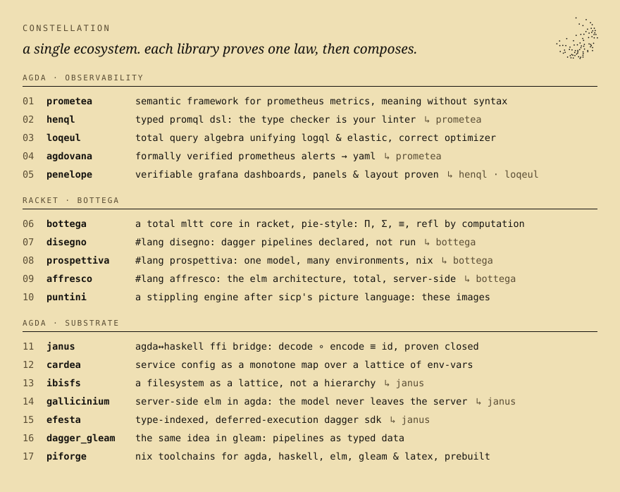
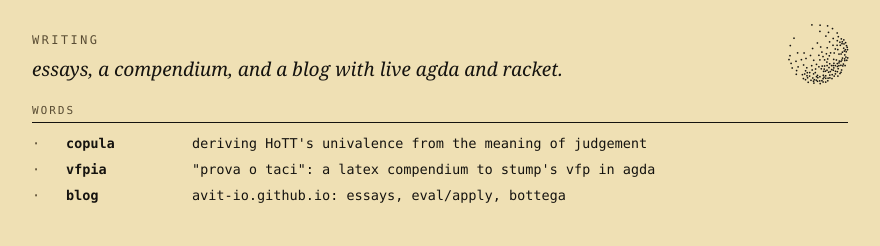
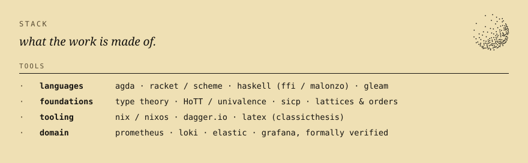

  <picture>
    <source media="(prefers-color-scheme: dark)" srcset="./banner-dark.svg" />
    
  </picture>

<code>a proof is a program; a language is data — two workshops, agda and racket</code>

  
  
  
  
  
  

---

### ● building

two workshops, one bet: **a proof is a test that covers *all* inputs, not a finite sample.**

- **agda** — a formally verified observability stack: metrics, logs, alerts and
  dashboards that are *correct by construction*. no dsl accepts a malformed query, no
  alert inverts a threshold, no dashboard panel renders empty.
- **racket** — the scheme of sicp, where code is data and eval/apply is the whole
  machine: **bottega**, a total mltt core in the style of pie, and a tower of `#lang`s
  on top whose tests are proofs.

---

  <picture>
    <source media="(prefers-color-scheme: dark)" srcset="./cards/constellation-dark.svg" />
    
  </picture>

---

  <picture>
    <source media="(prefers-color-scheme: dark)" srcset="./cards/writing-dark.svg" />
    
  </picture>

---

  <picture>
    <source media="(prefers-color-scheme: dark)" srcset="./cards/stack-dark.svg" />
    
  </picture>

---

### ● signs

  <picture>
    <source media="(prefers-color-scheme: dark)" srcset="https://github-readme-stats.vercel.app/api?username=avit-io&show_icons=true&hide_border=true&border_radius=0&bg_color=15130f&title_color=d6b866&icon_color=d6b866&text_color=ebddb2" />
    
  </picture>

  <picture>
    <source media="(prefers-color-scheme: dark)" srcset="https://github-readme-stats.vercel.app/api/top-langs/?username=avit-io&layout=compact&hide_border=true&border_radius=0&bg_color=15130f&title_color=d6b866&text_color=ebddb2" />
    
  </picture>

---

### ● connect

  
  
  

<code>● making invalid states unrepresentable · certainty by construction</code>
