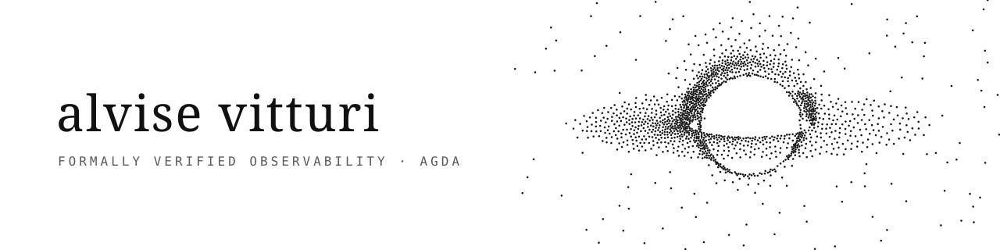

<p align="center">
  <picture>
    <source media="(prefers-color-scheme: dark)" srcset="./banner-dark.svg" />
    
  </picture>
</p>

<p align="center"><code>a proof is a program; a language is data — two workshops, agda and racket</code></p>

<p align="center">
  
  
  
  
  
  
</p>

---

### ● building

two workshops, one bet: **a proof is a test that covers *all* inputs, not a finite sample.**

- **agda** — a formally verified observability stack: metrics, logs, alerts and
  dashboards that are *correct by construction*. no dsl accepts a malformed query, no
  alert inverts a threshold, no dashboard panel renders empty.
- **racket** — the scheme of sicp, where code is data and eval/apply is the whole
  machine: **bottega**, a total mltt core in the style of pie, and a tower of `#lang`s
  on top whose tests are proofs.

---

### ● constellation

a single ecosystem. each library proves one law, then composes.

```
agda · observability
  01  prometea      semantic framework for prometheus metrics — meaning, no syntax
  02  henql         typed promql dsl — the type checker is your linter        ↳ prometea
  03  loqeul        total query algebra unifying logql & elastic, correct optimizer
  04  agdovana      formally verified prometheus alerts → yaml                ↳ prometea
  05  penelope      verifiable grafana dashboards, panels & layout proven     ↳ henql · loqeul

racket · bottega
  06  bottega       a total mltt core in racket, pie-style — Π, Σ, ≡, refl by computation
  07  disegno       #lang disegno — dagger pipelines declared, not run         ↳ bottega
  08  prospettiva   #lang prospettiva — one model, many environments, nix      ↳ bottega
  09  affresco      #lang affresco — the elm architecture, total, server-side  ↳ bottega
  10  puntini       a stippling engine after sicp's picture language — these images

agda · substrate
  11  janus         agda↔haskell ffi bridge — decode ∘ encode ≡ id, proven closed
  12  cardea        service config as a monotone map over a lattice of env-vars
  13  ibisfs        a filesystem as a lattice, not a hierarchy                ↳ janus
  14  gallicinium   server-side elm in agda — the model never leaves the server ↳ janus
  15  efesta        type-indexed, deferred-execution dagger sdk              ↳ janus
  16  dagger_gleam  the same idea in gleam — pipelines as typed data
  17  piforge       nix toolchains for agda, haskell, elm, gleam & latex — prebuilt
```

---

### ● writing

```
  copula              deriving HoTT's univalence from the meaning of judgement
  vfpia               "prova o taci" — a latex compendium to stump's vfp in agda
  avit-io.github.io   essays & notes, with live agda snippets
```

---

### ● stack

```
  languages    agda · racket / scheme · haskell (ffi / malonzo) · gleam
  foundations  type theory · HoTT / univalence · sicp · lattice & order theory
  tooling      nix / nixos · dagger.io · latex (classicthesis)
  domain       prometheus · loki · elastic · grafana — formally verified
```

---

### ● signs

<p align="center">
  
</p>

<p align="center">
  
</p>

---

### ● connect

<p align="left">
  <a href="https://www.linkedin.com/in/alvisevitturi"></a>
  <a href="mailto:avit-io@proton.me"></a>
  <a href="https://avit-io.github.io"></a>
</p>

<sub><code>● making invalid states unrepresentable · certainty by construction</code></sub>
